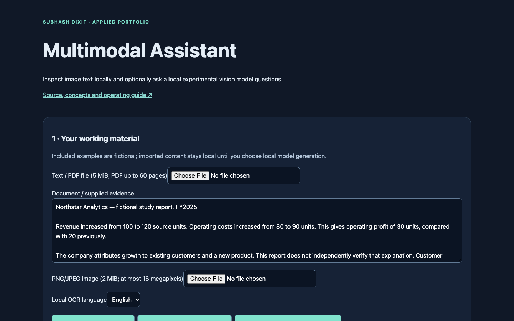
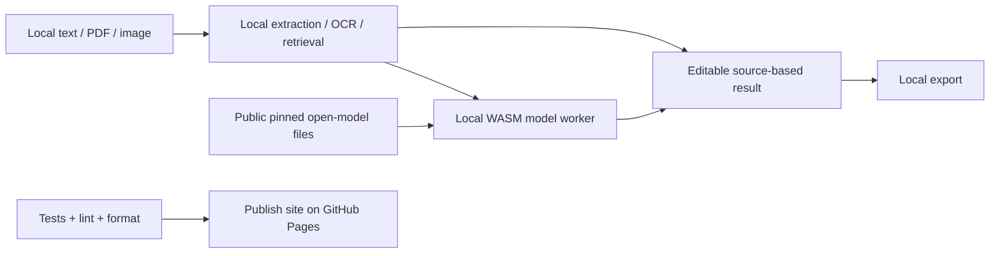
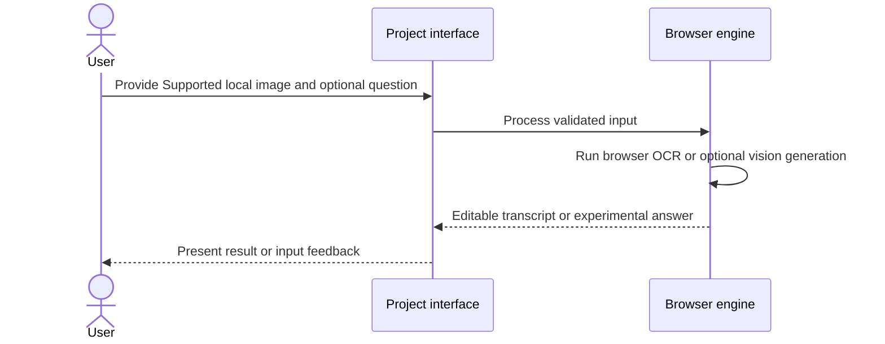
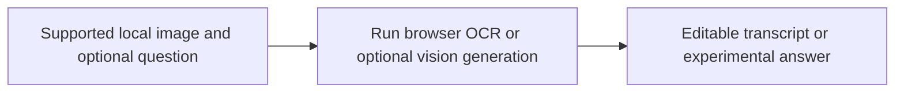

# Multimodal Assistant

## 1. Project overview

Browser text/image tools with local OCR and keyless open models; small-model vision is experimental.

[Live demo](https://subhashdixit.github.io/multimodal-assistant/) · [Source repository](https://github.com/subhashdixit/multimodal-assistant)



## 2. Motivation and problem statement

### Objective

Inspect text in an image and optionally ask a local vision model about it.

### Problem statement

OCR and image reasoning answer different questions and can both produce errors.

### Motivation

Keeping the transcript and generated answer visible helps users review what the local model inferred.

## 3. Solution and scope

**Inputs** — Supported local image and optional question. **Outputs** — Editable transcript or experimental answer.

### What the finished application does

- A complete HTML/JavaScript workflow with included example, file import, editable outputs and local export.
- Local evidence/extraction mode with explicit algorithm labels.
- Keyless local open-model generation with explicit downloads, progress and cancellation.
- Input size limits, provider errors and source/citation checks shown in the UI.

## 4. Quick start and usage

### Use the application step by step

1. Open the live application. Read the input labels and scope panel.
2. Start with the included example to understand the output.
3. Replace it with your own supported input. Files are processed locally unless you explicitly choose a server feature and consent to it.
4. Run the analysis and inspect the visual output together with its limitations.
5. Export your results when the tool offers a download. Keep your own copy; a browser tab is not a durable data store.

## 5. High-level architecture

### Architecture and data flow



The Render gateway is used only by the research workbench's fixed-source news reader in the default setup. Its legacy optional Gemini adapter remains available in source for comparison, but the seven interfaces do not need it or call it for generation. No Gemini key setup is required. Qwen is the default text option; the smaller SmolLM2 option is a lower-memory experiment with substantially weaker instruction following. Generated numbers not found in evidence are flagged conservatively; this check is not mathematical or factual verification. A sleeping news gateway can delay feed retrieval; local document/model tools remain independent.

## 6. End-to-end request workflow



## 7. Data sources, inputs, and outputs

| Input | Processing | Output |
| --- | --- | --- |
| Supported local image and optional question | Run browser OCR or optional vision generation | Editable transcript or experimental answer |

### Data provenance and attribution

Original source files are retained. Default analytical examples and the default invoice/profile are fictional. PDF.js 6.4.299 is Apache-2.0 licensed; its license is vendored with the worker. Tesseract.js 7.0.0 / Tesseract core and official tessdata_fast language data are vendored for local OCR with their license notices. English/Hindi language assets download from this same site only when needed.

## 8. Data flow and ETL pipeline



## 9. Low-level design and interfaces

Implementation entry points are [`site/index.html`](<site/index.html>), [`site/app.js`](<site/app.js>), [`site/documents.js`](<site/documents.js>), [`site/engine.js`](<site/engine.js>), [`site/local-model-worker.js`](<site/local-model-worker.js>).

## 10. Concepts and algorithms

- **OCR**. Estimate text from pixels with a browser OCR engine. Misread punctuation and numbers need manual review.
- **Vision-language inference**. Use a small downloaded vision model for image questions. Resizing reduces detail, and experimental results may contain unsupported descriptions.

## 11. Technology choices and dependencies

- **HTML, CSS, and JavaScript**. Serve a static browser interface with inspectable rendering and validation.
- **PDF.js**. Read selectable PDF text locally while preserving page references.
- **Tesseract.js**. Recognize visible text in the browser without an image upload.
- **Transformers.js and ONNX Runtime Web**. Run the optional downloaded model locally in a worker.

[Dependency versions and runtime rationale](DEPENDENCIES.md)

## 12. Training, inference, and evaluation

### What the browser checks established

The synthetic invoice passed local OCR and field reconciliation: subtotal 200 + tax 36 = total 236. This verifies that workflow on this fixture, not all invoice layouts. Text-model generation and vision-model inference both ran without API credentials. In an image-only test the small SmolVLM model hallucinated unrelated table details, so its option is explicitly **Experimental vision**. A running model is not evidence of accurate visual understanding.

For document use, prefer image → local OCR → inspect/correct transcript → extract/reconcile fields or ask the text model about that transcript. Selecting a text model does not send it image pixels. Sample text is cleared when loading an image so that unrelated examples cannot silently contaminate its analysis. Model-generated amounts are unverified until checked against the original and reconciled.

Validation code is available in [`tests/assets.test.js`](<tests/assets.test.js>), [`tests/engine.test.js`](<tests/engine.test.js>), [`tests/model-policy.test.js`](<tests/model-policy.test.js>).

## 13. Limitations and data handling

### Practical limits

Text/context ≤40,000 characters; local generation questions ≤600; local documents ≤5 MiB/60 pages; images ≤2 MiB/16 megapixels. Only PNG/JPEG for image analysis. No persistent document store or cross-device history. Source extraction can change reading order in complex PDFs. OCR and AI output require manual verification. Images are analyzed, not generated. No API key is needed for any default generation function.

The test suite checks calculation contracts and invalid inputs. It cannot establish that an input dataset is representative, that a heuristic is scientifically correct for every domain, or that a result is suitable for an automated consequential decision. Read the original source alongside the maintained browser implementation when comparing behavior.

## 14. Installation and local setup

### Run locally from scratch

Install Node.js 22 and Python 3 for a local static HTTP server. Python is not a production backend for this app.

```bash
git clone https://github.com/subhashdixit/multimodal-assistant.git
cd multimodal-assistant
npm ci
npm test
npm run lint
npm run format
npm run check
python3 -m http.server 8000 --directory site
```

Open http://localhost:8000. Use HTTP rather than double-clicking HTML so that module imports and local data fetches work consistently. No production API secret belongs in `site/`.

### Local dependency installation

The maintained app is HTML/CSS/JavaScript and needs no Python packages. `requirements.txt` documents this; install development tools with `npm ci` using the pinned Node/npm versions. See [DEPENDENCIES.md](DEPENDENCIES.md). Original prototype requirements are preserved at `archive/prototype-requirements.in` where present; they are not the supported install command.

## 15. Repository structure

### Coding structure

```text
site/
  index.html       # accessible application interface
  styles.css       # responsive design
  app.js           # interface orchestration
  engine.js        # validated calculations; no DOM dependency
  ui.js            # chart, CSV and download helpers
tests/             # behavior and boundary cases
.github/workflows/pages.yml
archive/           # original README and retired workflows where present
```

Original source files, notebooks and historical artifacts remain in the repository for comparison. The release publishes only `site/`; old source directories and datasets are not automatically exposed by the application.

## 16. Deployment and operations

### CI/CD and deployment

CI means continuous integration: each pull request and main-branch push installs exact lockfile dependencies, checks formatting, lints JavaScript, runs meaningful behavior tests and checks module syntax. A failed check stops publishing. CD means continuous deployment: after the required `Build and test` check succeeds on `main`, GitHub Actions uploads `site/` and GitHub Pages serves it over HTTPS.

The workflow uses pinned action revisions, minimal permissions and a protected main branch. Publishing jobs need Pages/OIDC permissions; test jobs only read source. Feature branches are deleted after merge. Static Pages hosting needs no always-running Python process, but cannot hide secrets, host a Flask process or provide durable server storage.

To set up a fork, enable GitHub Pages with **GitHub Actions** as its source and allow the repository's workflow to run. Repository Settings → Pages shows the deployment URL. If renaming the repository, update the README URL and any absolute links; application resources use relative paths. Check Actions logs if publishing fails.

#### Release, monitoring and rollback

A commit identifies exactly which source was deployed. Inspect the Actions deployment and test results before sharing the link. After publishing, open the page, run its example and check exports; a successful HTTP response alone is not a functional test. For rollback, revert the faulty merge in a new PR, pass checks, and merge the revert. This triggers the same reproducible publishing process. Avoid force-pushing protected main or deleting history. Browser caches can retain an older asset briefly; refresh after a deployment.

#### Docker and alternatives

Docker packages code and dependencies into a reproducible runtime. This static app does not require a container: Pages serves the same versioned files directly, with less operating work and no container cold starts. A container becomes useful if adding a Python backend; then secrets, patches, resource costs and persistent storage require separate management.

## 17. License, credits, and support

[Repository code license](LICENSE). Report reproducible issues through [GitHub Issues](https://github.com/subhashdixit/multimodal-assistant/issues).
