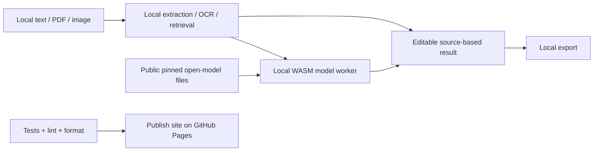

# Multimodal Assistant

[Open the application](https://subhashdixit.github.io/multimodal-assistant/) · [Report an issue](https://github.com/subhashdixit/multimodal-assistant/issues)

Inspect image text locally and optionally ask a server-side vision model questions.

## What the finished application does

- A complete HTML/JavaScript workflow with included example, file import, editable outputs and local export.
- Local evidence/extraction mode with explicit algorithm labels.
- Keyless local open-model generation with explicit downloads, progress and cancellation.
- Input size limits, provider errors and source/citation checks shown in the UI.

## Use the application step by step

1. Open the live application. Read the input labels and scope panel.
2. Start with the included example to understand the output.
3. Replace it with your own supported input. Files are processed locally unless you explicitly choose a server feature and consent to it.
4. Run the analysis and inspect the visual output together with its limitations.
5. Export your results when the tool offers a download. Keep your own copy; a browser tab is not a durable data store.

## Concepts, algorithms and interpretation

### Retrieval and generation have different jobs

Local BM25 ranks source excerpts using query-term rarity and document-length normalization (k1=1.2, b=0.75). It returns exact evidence and scores; a high lexical score is not an answer-confidence probability. An empty match means no evidence found. It cannot understand all paraphrases or resolve contradictory facts. Generation asks a downloaded open model to write an answer from supplied evidence in the browser; tool-specific instructions, no external execution tools and bounded output keep the workflow inspectable. An LLM may still hallucinate or follow malicious text, so source checking remains essential.

### Extraction and preprocessing

PDF.js reads selectable text page by page and preserves page markers. Scans have no guaranteed text layer. The local summarizer scores sentences by term frequency, normalized for length, and restores their original order. It copies source sentences rather than inventing an abstractive summary; it can miss rare but important details. OCR estimates characters from pixels and can misread punctuation, amounts and handwriting. Local invoice parsing is heuristic: missing fields remain null; subtotal + tax is compared with total, but discounts, shipping or multiple tax lines may require correction. Passing arithmetic does not authenticate an invoice.

### Free open models: no key required

Generation runs in a browser Web Worker with Transformers.js 4.3.2 (version-pinned official npm distribution via jsDelivr) and vendored ONNX Runtime Web WASM assets. The public library download is a network dependency; it receives routine connection metadata, not prompts. Text choices are [SmolLM2-135M-Instruct](https://huggingface.co/HuggingFaceTB/SmolLM2-135M-Instruct) (~137 MB q8 weights) and [Qwen2.5-0.5B-Instruct ONNX](https://huggingface.co/onnx-community/Qwen2.5-0.5B-Instruct) (~512 MB). Image tools also offer [SmolVLM-256M-Instruct](https://huggingface.co/HuggingFaceTB/SmolVLM-256M-Instruct) (~260 MB across three q8 components). Model revisions are pinned in `site/model-policy.js`; these models are Apache-2.0 licensed. Read each model card's limitations.

The first run downloads public weights/tokenizers from Hugging Face plus the same-origin WASM runtime. It requires network bandwidth, browser storage and sufficient RAM; memory use exceeds file size. Later runs may reuse browser cache. No API account/key, paid inference subscription or hosted model server is required. Browser cache eviction or model-host availability can require a fresh download. No perpetual hosting guarantee is implied.

Prompts and images stay in this browser's worker. There is no model-inference API request. The user explicitly starts the model download, progress is shown, and Stop terminates the worker. CPU/WASM uses one thread to work without Pages cross-origin-isolation headers. Model generation is limited to 3,500 evidence characters, 600 question characters, 1,800 input tokens and 160 new tokens; longer inputs must be shortened explicitly, rather than silently treated as fully read. Vision inputs are resized proportionally to a maximum 512-pixel edge. Detailed invoice OCR is better served by the separate local OCR/field-validation path.

These are small experimental models. Generated text can be repetitive, incomplete, unsupported or inconsistent with evidence. Citations are checked for known IDs, not factual entailment. Never infer that a generated number is correct because it looks plausible. The deterministic extractive/retrieval modes remain the more traceable option. Images are analyzed, not generated.

## Architecture and data flow



The Render gateway is used only by the research workbench's fixed-source news reader in the default setup. Its legacy optional Gemini adapter remains available in source for comparison, but the seven interfaces do not need it or call it for generation. No Gemini key setup is required. Qwen is the default text option; the smaller SmolLM2 option is a lower-memory experiment with substantially weaker instruction following. Generated numbers not found in evidence are flagged conservatively; this check is not mathematical or factual verification. A sleeping news gateway can delay feed retrieval; local document/model tools remain independent.

## Run locally from scratch

Install Node.js 22 and Python 3 for a local static HTTP server. Python is not a production backend for this app.

```bash
git clone https://github.com/subhashdixit/multimodal-assistant.git
cd multimodal-assistant
npm ci
npm test
npm run lint
npm run format
npm run check
python3 -m http.server 8000 --directory site
```

Open http://localhost:8000. Use HTTP rather than double-clicking HTML so that module imports and local data fetches work consistently. No production API secret belongs in `site/`.

## Coding structure

```text
site/
  index.html       # accessible application interface
  styles.css       # responsive design
  app.js           # interface orchestration
  engine.js        # validated calculations; no DOM dependency
  ui.js            # chart, CSV and download helpers
tests/             # behavior and boundary cases
.github/workflows/pages.yml
archive/           # original README and retired workflows where present
```

Original source files, notebooks and historical artifacts remain in the repository for comparison. The release publishes only `site/`; old source directories and datasets are not automatically exposed by the application.

## CI/CD and deployment

CI means continuous integration: each pull request and main-branch push installs exact lockfile dependencies, checks formatting, lints JavaScript, runs meaningful behavior tests and checks module syntax. A failed check stops publishing. CD means continuous deployment: after the required `Build and test` check succeeds on `main`, GitHub Actions uploads `site/` and GitHub Pages serves it over HTTPS.

The workflow uses pinned action revisions, minimal permissions and a protected main branch. Publishing jobs need Pages/OIDC permissions; test jobs only read source. Feature branches are deleted after merge. Static Pages hosting needs no always-running Python process, but cannot hide secrets, host a Flask process or provide durable server storage.

To set up a fork, enable GitHub Pages with **GitHub Actions** as its source and allow the repository's workflow to run. Repository Settings → Pages shows the deployment URL. If renaming the repository, update the README URL and any absolute links; application resources use relative paths. Check Actions logs if publishing fails.

### Release, monitoring and rollback

A commit identifies exactly which source was deployed. Inspect the Actions deployment and test results before sharing the link. After publishing, open the page, run its example and check exports; a successful HTTP response alone is not a functional test. For rollback, revert the faulty merge in a new PR, pass checks, and merge the revert. This triggers the same reproducible publishing process. Avoid force-pushing protected main or deleting history. Browser caches can retain an older asset briefly; refresh after a deployment.

### Docker and alternatives

Docker packages code and dependencies into a reproducible runtime. This static app does not require a container: Pages serves the same versioned files directly, with less operating work and no container cold starts. A container becomes useful if adding a Python backend; then secrets, patches, resource costs and persistent storage require separate management.

## Data provenance and attribution

Original source files are retained. Default analytical examples and the default invoice/profile are fictional. PDF.js 6.4.299 is Apache-2.0 licensed; its license is vendored with the worker. Tesseract.js 7.0.0 / Tesseract core and official tessdata_fast language data are vendored for local OCR with their license notices. English/Hindi language assets download from this same site only when needed. 

## Practical limits

Text/context ≤40,000 characters; local generation questions ≤600; local documents ≤5 MiB/60 pages; images ≤2 MiB/16 megapixels. Only PNG/JPEG for image analysis. No persistent document store or cross-device history. Source extraction can change reading order in complex PDFs. OCR and AI output require manual verification. Images are analyzed, not generated. No API key is needed for any default generation function.

The test suite checks calculation contracts and invalid inputs. It cannot establish that an input dataset is representative, that a heuristic is scientifically correct for every domain, or that a result is suitable for an automated consequential decision. Read the original source alongside the maintained browser implementation when comparing behavior.
