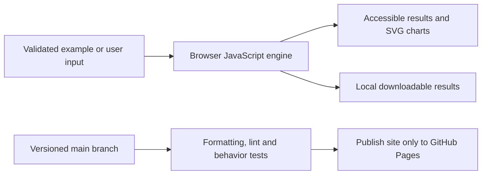

# Multimodal Assistant

[Open the application](https://subhashdixit.github.io/multimodal-assistant/) · [Report an issue](https://github.com/subhashdixit/multimodal-assistant/issues)

Inspect image text locally and optionally ask a server-side vision model questions.

## What the finished application does

- A complete HTML/JavaScript workflow with included example, file import, editable outputs and local export.
- Local evidence/extraction mode with explicit algorithm labels.
- Optional real Gemini generation through a credential-isolating Render gateway, enabled only after configuration and consent.
- Input size limits, provider errors and source/citation checks shown in the UI.

## Use the application step by step

1. Open the live application. Read the input labels and scope panel.
2. Start with the included example to understand the output.
3. Replace it with your own supported input. Files are processed locally unless you explicitly choose a server feature and consent to it.
4. Run the analysis and inspect the visual output together with its limitations.
5. Export your results when the tool offers a download. Keep your own copy; a browser tab is not a durable data store.

## Concepts, algorithms and interpretation

### Retrieval and generation have different jobs

Local BM25 ranks source excerpts using query-term rarity and document-length normalization (k1=1.2, b=0.75). It returns exact evidence and scores; a high lexical score is not an answer-confidence probability. An empty match means no evidence found. It cannot understand all paraphrases or resolve contradictory facts. Generation asks Gemini to write an answer from the supplied evidence; the gateway uses tool-specific instructions, no browsing/execution tools, low temperature and bounded output. An LLM may still hallucinate or follow malicious text, so source checking remains essential.

### Extraction and preprocessing

PDF.js reads selectable text page by page and preserves page markers. Scans have no guaranteed text layer. The local summarizer scores sentences by term frequency, normalized for length, and restores their original order. It copies source sentences rather than inventing an abstractive summary; it can miss rare but important details. OCR estimates characters from pixels and can misread punctuation, amounts and handwriting. Local invoice parsing is heuristic: missing fields remain null; subtotal + tax is compared with total, but discounts, shipping or multiple tax lines may require correction. Passing arithmetic does not authenticate an invoice.

### Provider boundaries

The original obsolete PaLM/Gemini-pro code remains historical material. The maintained gateway uses a configurable current Gemini model. Keys stay in Render environment variables and never enter the Pages bundle. A present key is not proof of working quota or model access. If unavailable, the interface reports that honestly; local extraction/retrieval remains usable. No model-generated result is substituted with a pretend AI response.


## Architecture and data flow



HTML provides the accessible page structure, CSS handles responsive layout, and ES modules separate calculation from user interaction. Pure calculation functions can run in Node tests without a browser. SVG charts scale with the screen; they use explicit axes, labels and legends. CSV exports escape spreadsheet formula prefixes in text cells.

### Optional Render gateway

The shared service source is versioned in [ai-research-workbench/backend](https://github.com/subhashdixit/ai-research-workbench/tree/main/backend). All seven portfolio AI interfaces can use the same small gateway; each keeps its own UI and local logic. `site/config.json` contains only its public URL, never a secret. For independent hosting, clone that backend repository, run its tests and deploy its `render.yaml`; point this app's config at your URL. Configure `ALLOWED_ORIGINS` to your Pages origin.

On Render use the **Free** plan and set `GEMINI_API_KEY` directly in Environment, plus optional `GEMINI_MODEL`. Never paste keys into issues, source or browser JavaScript. Check `/health/ready`, then a real consented request before claiming provider generation works. Health exposes only a configured boolean. Free Render instances can sleep and share workspace runtime allowances; model providers have their own quotas and terms. No always-on or permanent-free guarantee is implied.

The gateway rate-limits clients, caps global calls, allows two concurrent requests and rejects oversized inputs. These are demo limits, not a distributed billing firewall or an authentication system. No prompts/images/outputs are stored by its application code. Normal hosting/provider connection logs and provider data policies still apply. A fork should review those policies before accepting sensitive data.


## Run locally from scratch

Install Node.js 22 and Python 3 for a local static HTTP server. Python is not a production backend for this app.

```bash
git clone https://github.com/subhashdixit/multimodal-assistant.git
cd multimodal-assistant
npm ci
npm test
npm run lint
npm run format
npm run check
python3 -m http.server 8000 --directory site
```

Open http://localhost:8000. Use HTTP rather than double-clicking HTML so that module imports and local data fetches work consistently. No production API secret belongs in `site/`.

## Coding structure

```text
site/
  index.html       # accessible application interface
  styles.css       # responsive design
  app.js           # interface orchestration
  engine.js        # validated calculations; no DOM dependency
  ui.js            # chart, CSV and download helpers
tests/             # behavior and boundary cases
.github/workflows/pages.yml
archive/           # original README and retired workflows where present
```

Original source files, notebooks and historical artifacts remain in the repository for comparison. The release publishes only `site/`; old source directories and datasets are not automatically exposed by the application.

## CI/CD and deployment

CI means continuous integration: each pull request and main-branch push installs exact lockfile dependencies, checks formatting, lints JavaScript, runs meaningful behavior tests and checks module syntax. A failed check stops publishing. CD means continuous deployment: after the required `Build and test` check succeeds on `main`, GitHub Actions uploads `site/` and GitHub Pages serves it over HTTPS.

The workflow uses pinned action revisions, minimal permissions and a protected main branch. Publishing jobs need Pages/OIDC permissions; test jobs only read source. Feature branches are deleted after merge. Static Pages hosting needs no always-running Python process, but cannot hide secrets, host a Flask process or provide durable server storage.

To set up a fork, enable GitHub Pages with **GitHub Actions** as its source and allow the repository's workflow to run. Repository Settings → Pages shows the deployment URL. If renaming the repository, update the README URL and any absolute links; application resources use relative paths. Check Actions logs if publishing fails.

### Release, monitoring and rollback

A commit identifies exactly which source was deployed. Inspect the Actions deployment and test results before sharing the link. After publishing, open the page, run its example and check exports; a successful HTTP response alone is not a functional test. For rollback, revert the faulty merge in a new PR, pass checks, and merge the revert. This triggers the same reproducible publishing process. Avoid force-pushing protected main or deleting history. Browser caches can retain an older asset briefly; refresh after a deployment.

### Docker and alternatives

Docker packages code and dependencies into a reproducible runtime. This static app does not require a container: Pages serves the same versioned files directly, with less operating work and no container cold starts. A container becomes useful if adding a Python backend; then secrets, patches, resource costs and persistent storage require separate management.

## Data provenance and attribution

Original source files are retained. Default analytical examples and the default invoice/profile are fictional. PDF.js 6.4.299 is Apache-2.0 licensed; its license is vendored with the worker. Tesseract.js 7.0.0 / Tesseract core and official tessdata_fast language data are vendored for local OCR with their license notices. English/Hindi language assets download from this same site only when needed. 

## Practical limits

Text/context ≤40,000 characters; questions sent to the provider ≤4,000; local documents ≤5 MiB/60 pages; images ≤2 MiB/16 megapixels. Only PNG/JPEG for image analysis. No persistent document store or cross-device history. Source extraction can change reading order in complex PDFs. OCR and AI output require manual verification. Images are analyzed, not generated. No secrets are needed for local functions.

The test suite checks calculation contracts and invalid inputs. It cannot establish that an input dataset is representative, that a heuristic is scientifically correct for every domain, or that a result is suitable for an automated consequential decision. Read the original source alongside the maintained browser implementation when comparing behavior.
